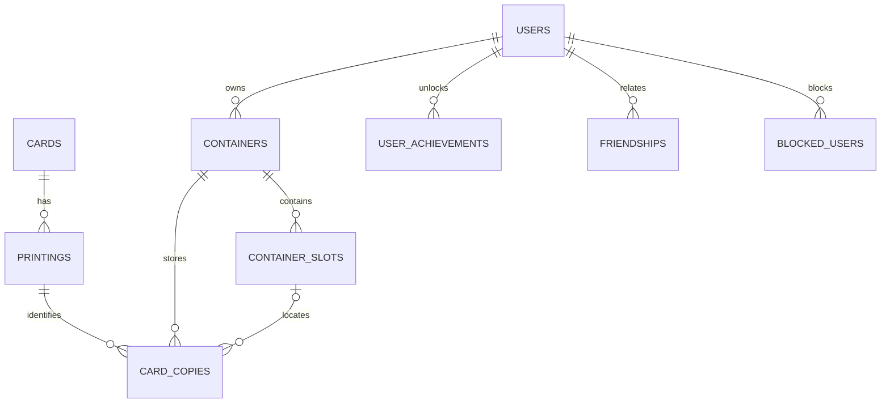

*Este proyecto se ha creado como parte del currículo de 42 por albealva, mgrandia, gasroman y avelandr.*

# Card Binder Pro

Card Binder Pro es una aplicación web para organizar una colección de Magic: The Gathering. Permite buscar cartas, registrar copias físicas, ubicarlas en archivadores, mazos o cajas, revisar la colección, relacionarse con otros usuarios y jugar online.

El README está completo salvo por los campos de autoría individual, que cada miembro del equipo rellenará antes de la entrega.

## Descripción

El proyecto conecta un catálogo de cartas con un inventario personal. Una carta no es lo mismo que una impresión ni que una copia física: una carta puede tener muchas impresiones, y una persona puede guardar varias copias con estados, idiomas, acabados foil y ubicaciones distintos.

Funciones principales:

- Buscar cartas con filtros, ordenación y paginación.
- Gestionar la colección en archivadores, mazos y cajas, incluyendo estado, idioma, foil y notas.
- Importar y exportar colecciones en CSV y JSON.
- Consultar informes y vistas de los contenedores.
- Iniciar sesión con cuenta local o OAuth de 42; usar perfiles, avatares, amistades, presencia y mensajes directos.
- Usar chat en tiempo real y jugar a dos juegos online: Pong isométrico y Adivina Cartas multijugador.
- Crear salas y partidas de Pong configurables, con modo espectador.
- Consultar estadísticas, historial, logros y progreso de colección.

## Tecnologías y decisiones

| Área | Tecnologías | Motivo |
|---|---|---|
| Portal principal | HTML, CSS, JavaScript y utilidades Tailwind CSS | Mantiene ligera la interfaz de colección y permite organizar código por página con una paleta visual compartida. |
| Cliente de Pong | React 18 y Vite | Ofrece una interfaz de juego en vivo basada en componentes. React se usa en Pong; el portal principal sigue en JavaScript vanilla. |
| Backend | Python y FastAPI | Estructura las rutas API, valida peticiones y ofrece documentación OpenAPI y WebSockets. |
| Base de datos | PostgreSQL 15 | Las tablas relacionales y claves foráneas representan usuarios, cartas, impresiones, copias, contenedores y relaciones sociales. |
| Despliegue | Docker Compose y Nginx | Ejecuta la base de datos, la API y el servidor web; Nginx sirve el frontend y redirige API y WebSockets. |
| Entorno local | Make y Python 3 | Facilita la preparación, la importación del catálogo, la consulta del estado y las pruebas de humo. |
| Documentación | Markdown convertido con Python-Markdown durante la compilación del frontend | El portal muestra estas mismas fuentes en inglés y español. |

## Arquitectura

```text
Navegador
  └── HTTPS :8443 / HTTP :8080
       └── Nginx
            ├── sirve HTML, CSS, JavaScript y el cliente React compilado
            ├── redirige /api/ a FastAPI
            └── redirige WebSockets a FastAPI
                 └── FastAPI
                      └── PostgreSQL
```

Docker Compose ejecuta PostgreSQL, el backend FastAPI y Nginx. La base de datos y los avatares usan volúmenes Docker. El cliente Pong se compila dentro de la imagen de Nginx.

La página de documentación del portal se genera desde `README.md` y `README.es.md` al compilar la imagen del frontend, para mantener sincronizado su contenido con estos documentos.

## Esquema de base de datos

Las relaciones principales son:



- `users` guarda cuentas locales y de 42.
- `cards` representa la identidad común de una carta; `printings` guarda las ediciones e imágenes de cada set.
- `containers`, `container_slots` y `card_copies` modelan la colección física y su ubicación.
- Las relaciones sociales se guardan en `friendships` y `blocked_users`.
- `user_achievements` conserva los hitos permanentes de colección. Otros progresos se calculan a partir de los datos actuales.
- El servicio de estadísticas crea las tablas de resultados de partidas y jugadores.

El esquema inicial está en `database/init.sql`; algunos servicios del backend crean tablas durante la ejecución.

## Equipo

| Login de 42 | Rol(es) | Responsabilidades |
|---|---|---|
| `gasroman` | Product Owner, DBA, Developer | Prioridades y validación del producto; responsabilidad de base de datos; desarrollo. |
| `albealva` | Project Manager, Tech Lead/Architect, QA, DevOps, Developer | Coordinación, arquitectura, comprobaciones de calidad, despliegue y desarrollo. |
| `mgrandia` | Frontend Developer, Developer | Desarrollo frontend. |
| `avelandr` | Frontend Developer, Developer | Desarrollo frontend. |

Todos los miembros participaron como desarrolladores. Cada miembro completará su contribución individual en la sección correspondiente.

## Organización del proyecto

El equipo usó GitHub para organizar el proyecto y seguir el código y las tareas. Las tareas ligadas a un rol se asignaban a ese rol. Para las demás, se ofrecía el trabajo y lo asumía quien consideraba que podía realizarlo mejor.

Se celebraba una reunión semanal por Google Meet o presencial. WhatsApp se usaba para la comunicación diaria.

## Funciones y módulos

Los módulos base seleccionados suman 14 puntos: 2 por cada Major y 1 por cada Minor. Cada módulo debe demostrarse como plenamente funcional durante la evaluación.

| Módulo | Tipo | Puntos | Evidencia en el proyecto | Rutas principales | Colaboradores |
|---|---:|---:|---|---|---|
| Framework frontend y backend | Major | 2 | React en el cliente de Pong y FastAPI en el backend. | `pong-client/package.json`, `backend/main.py` | Completar autor(es) |
| Funciones en tiempo real | Major | 2 | WebSockets para estado de juegos, salas y chat. | `backend/routers/pong_game.py`, `backend/routers/game.py`, `backend/routers/chat.py` | Completar autor(es) |
| Interacción entre usuarios | Major | 2 | Chat, perfiles y relaciones de amistad. | `backend/routers/social.py`, `backend/routers/profile.py`, `frontend/js/pages/profile.js` | Completar autor(es) |
| Gestión estándar de usuarios | Major | 2 | Perfiles, avatares, amistades y presencia online. | `backend/routers/auth.py`, `backend/routers/profile.py`, `backend/presence.py` | Completar autor(es) |
| Juego web completo | Major | 2 | Pong con partidas en vivo, reglas y condiciones de victoria. | `backend/routers/pong_game.py`, `pong-client/src/pong_App.jsx` | Completar autor(es) |
| Jugadores remotos | Major | 2 | Salas de Pong online y reconexión de jugadores. | `backend/routers/pong_game.py`, `pong-client/src/pong_App.jsx` | Completar autor(es) |
| OAuth 2.0 | Minor | 1 | Inicio de sesión con 42. | `backend/routers/auth.py`, `docker/nginx.conf` | Completar autor(es) |
| Importación y exportación de datos | Minor | 1 | CSV y JSON con validación de importación. | `backend/routers/dataio.py`, `frontend/js/pages/dataio.js` | Completar autor(es) |
| **Total base seleccionado** |  | **14** |  |  |  |

Los primeros seis módulos son Majors; los dos Minors completan la base de 14. La interacción entre usuarios se demuestra con funciones sociales (chat, perfiles y amistades), mientras que la gestión estándar se demuestra con cuentas, perfiles/avatares y presencia. React se usa en Pong; el portal principal usa JavaScript vanilla.

### Retos técnicos y soluciones

| Reto | Solución aplicada | Código relacionado | Colaboradores |
|---|---|---|---|
| Representar una colección física sin mezclar carta, impresión y copia | Registros relacionales separados y claves foráneas conectan catálogo, impresiones, contenedores, huecos y copias. | `database/init.sql`, `backend/routers/containers.py` | Completar autor(es) |
| Evitar que escrituras simultáneas superen la capacidad del contenedor | El backend valida la operación y devuelve conflicto; la interfaz explica el rechazo para que se pueda actualizar y reintentar. | `backend/routers/containers.py`, `frontend/js/pages/visor-admin-25d.js` | Completar autor(es) |
| Mantener correctos los callbacks OAuth detrás de Nginx en localhost y por IP LAN | El proxy conserva host y puerto; el callback se deriva de la petición y el preflight valida secretos y TLS local. | `docker/nginx.conf`, `backend/routers/auth.py`, `tools/prepare_local.py` | Completar autor(es) |
| Mantener consistente el estado multijugador ante desconexiones y espectadores | El servidor conserva el estado de Pong y reconecta al jugador a la sala existente; las conexiones de espectadores se separan de las plazas de jugador. | `backend/routers/pong_game.py`, `pong-client/src/pong_App.jsx` | Completar autor(es) |
| Arrancar el proyecto de forma predecible y preparar una evaluación sin Internet | El preflight de Make valida configuración/TLS; la carga habitual y el catálogo de emergencia usan comandos separados. | `Makefile`, `tools/prepare_local.py`, `tools/install_emergency_catalog.py` | Completar autor(es) |

Son áreas de trabajo agrupadas, no una afirmación de que una sola persona realizara cada área. Cada colaborador debe añadir su nombre a las filas pertinentes y describir su contribución concreta en la sección siguiente.

### Módulos de reserva para la evaluación

Son alternativas para demostrar si no se acepta un punto base, o candidatos adicionales para el bonus. El subject permite hasta 5 puntos de bonus después de alcanzar 14. Solo se seleccionarán módulos que superen su demostración.

| Candidato | Puntos | Demostración que preparar |
|---|---:|---|
| Multijugador con más de dos jugadores activos | Major · 2 | Entrar con al menos tres usuarios distintos a una sala de Adivina Cartas; comprobar rondas, temporizador, puntuaciones y clasificación compartidos. Los espectadores no cuentan como jugadores activos. |
| Estadísticas e historial de partidas | Minor · 1 | Terminar partidas y comprobar victorias/derrotas, historial, oponentes, clasificación y persistencia tras recargar. |
| Modo espectador | Minor · 1 | Entrar en una partida Pong ya iniciada, comprobar estado inicial y actualizaciones en directo, verificar que el espectador no controla palas y observar desconexión y fin. Ya se han probado hasta diez espectadores. |
| Personalización del juego | Minor · 1 | Cambiar modo, condición de victoria, límite de puntos/tiempo, orbe y tapete; comprobar opciones por defecto y configuración idéntica para ambos jugadores. |
| Gamificación | Minor · 1 | Demostrar logros, clasificación y XP/niveles; comprobar que primer contenedor/primera carta persisten tras vaciar la colección y que el progreso dinámico sigue el estado actual de la base de datos. |
| Chat avanzado | Minor · 1 | Demostrar bloqueo, invitaciones a partidas desde el chat, avisos de juego, acceso a perfiles, historial persistente, indicador de escritura y confirmaciones de lectura. |
| Búsqueda avanzada | Minor · 1 | Combinar filtros, cambiar sentido de ordenación y recorrer resultados con 12, 24, 36 y 52 cartas por página. |
| Sistema de notificaciones completo | Minor · 1 | Probar creación, modificación y borrado de contenedores y cartas, además de eventos de juego; registrar qué aparece en campana, pop-ups o mensajes. |
| Navegadores adicionales | Minor · 1 | Repetir flujos importantes en Firefox y Opera, además de Chrome; revisar funcionalidad, aspecto y consola. |
| Sistema de diseño propio | Minor · 1 | Inventariar y localizar al menos diez componentes reutilizables y mostrar la paleta, tipografía e iconos compartidos. |
| Módulo propio de gestión de colecciones | Major · 2 | Justificar su valor sustancial frente a un CRUD genérico; demostrar aislamiento de propiedad, ubicación de inventario y capacidad/concurrencia. |
| Módulo propio de progresión de colección | Minor · 1 | Explicar cómo los hitos de colección se diferencian de la gamificación estándar y demostrar sus reglas de persistencia. |

La subida de archivos no se incluye como reserva porque el flujo de avatar no se ha verificado frente a todos los requisitos del subject, incluido el progreso de carga y los tipos admitidos. Tampoco se incluye el Major de segundo juego con matchmaking: las salas actuales se eligen manualmente, sin emparejamiento automático.

## Instrucciones

### Requisitos previos

- Docker Engine y el complemento Docker Compose.
- GNU Make.
- Python 3 y OpenSSL instalados en el equipo.
- Internet para la primera descarga del catálogo Scryfall, salvo que se use el catálogo de emergencia.

Node se usa dentro de la compilación Docker del frontend; no hace falta instalarlo en el equipo anfitrión.

### Configurar y arrancar

1. Crea un `.env` local desde la plantilla o copia la configuración privada del equipo en la raíz del repositorio. **No lo subas a Git.**
2. Rellena credenciales de base de datos, secreto JWT y credenciales OAuth de 42. La preparación previa valida estos valores y restringe los permisos del fichero.
3. Ejecuta:

   ```bash
   make up
   ```

   La preparación crea o valida un certificado TLS autofirmado para localhost y la IPv4 LAN detectada. Después Docker Compose construye e inicia los servicios.
4. Carga el catálogo de cartas:

   ```bash
   make seed
   ```

   Si falta el archivo bulk local, lo descarga de Scryfall y luego lo importa. La primera descarga requiere Internet.
5. Abre `https://localhost:8443`. Desde otro dispositivo usa `https://<IP-LAN>:8443`. El certificado local es autofirmado; el navegador puede pedir que se confíe en él.

Para una evaluación sin Internet, coloca el ZIP de emergencia fuera del repositorio (por defecto `/tmp/card-binder-emergency.zip`) y ejecuta `make emergency`. Es una alternativa opcional, no se guarda en Git.

### Comandos útiles

| Comando | Para qué sirve |
|---|---|
| `make up` | Valida configuración, prepara TLS e inicia los servicios. |
| `make restart` | Reconstruye y recrea servicios conservando volúmenes Docker. |
| `make status` | Muestra el estado de los servicios. |
| `make logs` | Sigue los logs de los servicios. |
| `make test` | Ejecuta comprobaciones de humo de solo lectura para HTTPS, API y base de datos. |
| `make down` | Detiene servicios y conserva volúmenes. |
| `make clean` | Elimina contenedores, imágenes y volúmenes del proyecto; borra los datos guardados. |
| `make prune` | Ejecuta Docker system prune; puede afectar recursos Docker no usados fuera de este proyecto. |

## Recursos y uso de IA

Referencias del proyecto:

- [Documentación de FastAPI](https://fastapi.tiangolo.com/)
- [Documentación de React](https://react.dev/)
- [Documentación de PostgreSQL](https://www.postgresql.org/docs/)
- [Documentación de Docker Compose](https://docs.docker.com/compose/)
- [Documentación de Tailwind CSS](https://tailwindcss.com/docs)
- [Documentación de la API Scryfall](https://scryfall.com/docs/api)
- [Documentación de la API GIPHY](https://developers.giphy.com/docs/)

Claude y ChatGPT se usaron como herramientas de asesoría para el Product Owner, especialmente en el alcance y la priorización del producto. También ayudaron con documentación, scripts de smoke test, planificación de pruebas de casos límite, correcciones repetitivas en frontend y backend, debates de refactorización y mejoras de estabilidad. Los colaboradores humanos revisaron, corrigieron y probaron las propuestas pertinentes antes de confiar en ellas. La IA no es una función integrada en el producto.

## Contribuciones individuales

Cada miembro debe completar su fila. Agrupad funciones relacionadas, indicad las rutas de código pertinentes y explicad un reto importante y cómo se resolvió. Se pueden incluir tareas de implementación, revisión, pruebas o integración; no se presupone que cada función tenga una única persona responsable.

| Login de 42 | Funciones/módulos y rutas de código | Reto y solución |
|---|---|---|
| `gasroman` | Completar autor | Completar autor |
| `albealva` | Completar autor | Completar autor |
| `mgrandia` | Completar autor | Completar autor |
| `avelandr` | Completar autor | Completar autor |

## Créditos

Los datos del catálogo y las referencias a imágenes de cartas se obtienen de Scryfall. La búsqueda de GIF usa GIPHY. El repositorio incluye recursos de terceros; cuando se proporciona información de licencia o atribución junto a esos recursos, debe conservarse.

