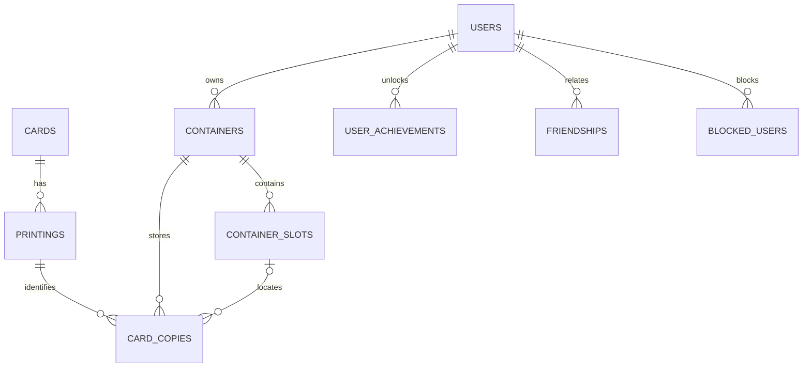

*This project has been created as part of the 42 curriculum by albealva, mgrandia, gasroman, avelandr.*

# Card Binder Pro

Card Binder Pro is a web application for organizing a Magic: The Gathering collection. Users can search for cards, record physical copies, place them in binders, decks or boxes, review their collection, interact with other users and play online games.

The README is complete apart from the individual author fields, which each team member will fill in before submission.

## Description

The project connects a searchable card catalog with a personal inventory. A card is not the same as a printing or a physical copy: one card can have many printings, and a user can own several copies with different conditions, languages, foil finishes and locations.

Key features include:

- Card search with filters, sorting and pagination.
- Collection management across binders, decks and boxes, including copy condition, language, foil and notes.
- Import and export of collections in CSV and JSON.
- Collection reports and visual views of containers.
- Local and 42 OAuth sign-in, user profiles, avatars, friends, presence and direct messages.
- Real-time chat and two online games: an isometric Pong game and a multiplayer card-guessing game.
- Pong lobbies, configurable matches and spectator support.
- Statistics, match history, achievements and collection progression.

## Technical stack and choices

| Area | Technologies | Why |
|---|---|---|
| Main portal | HTML, CSS, JavaScript and Tailwind CSS utilities | Keeps the collection interface lightweight and lets the team use page-specific code with a shared visual palette. |
| Pong client | React 18 and Vite | Provides a component-based client for the live game interface. React is used in the Pong client; the main portal remains vanilla JavaScript. |
| Backend | Python and FastAPI | Provides structured API routes, request validation, OpenAPI documentation and WebSocket endpoints. |
| Database | PostgreSQL 15 | Relational tables and foreign keys represent users, card data, printings, copies, containers and social relationships. |
| Delivery | Docker Compose and Nginx | Runs the database, API and web server as services; Nginx serves the frontend and proxies API and WebSocket traffic. |
| Local setup | Make and Python 3 | Provides repeatable setup, catalog import, status and smoke-check commands. |
| Project documentation | Markdown rendered with Python-Markdown during the frontend image build | The portal displays these same English and Spanish README sources. |

## Architecture

```text
Browser
  └── HTTPS :8443 / HTTP :8080
       └── Nginx
            ├── serves static HTML, CSS, JavaScript and the built React Pong client
            ├── proxies /api/ to FastAPI
            └── proxies WebSocket connections to FastAPI
                 └── FastAPI
                      └── PostgreSQL
```

Docker Compose runs PostgreSQL, the FastAPI backend and Nginx. The database and uploaded avatars use Docker volumes. The Pong client is built into the Nginx image.

The portal's project overview is generated from `README.md` and `README.es.md` during the frontend image build, keeping its content aligned with the repository documents.

## Database schema

The main relationships are:



- `users` stores local and 42 accounts.
- `cards` stores a card’s shared identity; `printings` stores set-specific editions and image references.
- `containers`, `container_slots` and `card_copies` model the user’s physical collection and its location.
- Social relationships are stored in `friendships` and `blocked_users`.
- `user_achievements` stores permanent collection milestones. Other progress is calculated from current database records.
- Game results and player rows are created by the statistics service.

The initial schema is in `database/init.sql`; some runtime tables are created by their backend services.

## Team information

| 42 login | Role(s) | Responsibilities |
|---|---|---|
| `gasroman` | Product Owner, DBA, Developer | Product priorities and validation; database responsibilities; implementation. |
| `albealva` | Project Manager, Tech Lead/Architect, QA, DevOps, Developer | Coordination, architecture, quality checks, deployment and implementation. |
| `mgrandia` | Frontend Developer, Developer | Frontend implementation. |
| `avelandr` | Frontend Developer, Developer | Frontend implementation. |

All team members contributed as developers. Individual feature ownership is recorded in the contribution section below for each member to complete.

## Project management

The team used GitHub to organize the project and track its code and tasks. A task tied to a specific role was handled by that role. For other tasks, team members volunteered for the work they felt best prepared to complete.

The team held one weekly meeting, either on Google Meet or in person, and used WhatsApp for day-to-day communication.

## Features and modules

The selected base modules total 14 points: 2 points per Major and 1 per Minor. Each module should be demonstrated as fully functional during evaluation.

| Module | Type | Points | Evidence in the project | Main code locations | Contributors |
|---|---:|---:|---|---|---|
| Frontend and backend frameworks | Major | 2 | React in the Pong client and FastAPI in the backend. | `pong-client/package.json`, `backend/main.py` | Fill in author(s) |
| Real-time features | Major | 2 | WebSockets for game state, lobbies and chat. | `backend/routers/pong_game.py`, `backend/routers/game.py`, `backend/routers/chat.py` | Fill in author(s) |
| User interaction | Major | 2 | Chat, user profiles and friend relationships. | `backend/routers/social.py`, `backend/routers/profile.py`, `frontend/js/pages/profile.js` | Fill in author(s) |
| Standard user management | Major | 2 | Profiles, avatars, friends and online presence. | `backend/routers/auth.py`, `backend/routers/profile.py`, `backend/presence.py` | Fill in author(s) |
| Complete web game | Major | 2 | Pong has live play, rules and win conditions. | `backend/routers/pong_game.py`, `pong-client/src/pong_App.jsx` | Fill in author(s) |
| Remote players | Major | 2 | Online Pong rooms and player reconnection. | `backend/routers/pong_game.py`, `pong-client/src/pong_App.jsx` | Fill in author(s) |
| OAuth 2.0 | Minor | 1 | Sign-in with 42. | `backend/routers/auth.py`, `docker/nginx.conf` | Fill in author(s) |
| Data import and export | Minor | 1 | Collection import/export in CSV and JSON with validation. | `backend/routers/dataio.py`, `frontend/js/pages/dataio.js` | Fill in author(s) |
| **Selected base total** |  | **14** |  |  |  |

The first six entries are Majors; the two Minors complete the 14-point base. User interaction is evidenced by social features (chat, profiles and friend relationships), while user management is evidenced by account lifecycle, profile/avatar and presence capabilities. React is used in the Pong client; the main portal uses vanilla JavaScript.

### Engineering challenges and solutions

| Challenge | Approach used | Relevant code | Contributors |
|---|---|---|---|
| Representing a physical collection without mixing a card, a printing and an owned copy | Separate relational records and foreign keys connect the card catalog, printings, containers, slots and copies. | `database/init.sql`, `backend/routers/containers.py` | Fill in author(s) |
| Preventing collection writes from silently exceeding container capacity during concurrent use | The backend validates the operation and returns a conflict response; the interface reports the rejected action so the user can refresh and retry. | `backend/routers/containers.py`, `frontend/js/pages/visor-admin-25d.js` | Fill in author(s) |
| Keeping OAuth callbacks correct behind Nginx for localhost and LAN access | Forward the original host and port through the proxy and derive the callback from the request; preflight checks local secrets and TLS. | `docker/nginx.conf`, `backend/routers/auth.py`, `tools/prepare_local.py` | Fill in author(s) |
| Keeping multiplayer state consistent through disconnects and spectator joins | The server owns Pong state and reconnects a player to the existing room; spectator connections are tracked separately from player slots. | `backend/routers/pong_game.py`, `pong-client/src/pong_App.jsx` | Fill in author(s) |
| Starting the project predictably and preparing for an offline evaluation | A Make preflight validates configuration/TLS; catalog bootstrap and the optional emergency catalog use separate commands. | `Makefile`, `tools/prepare_local.py`, `tools/install_emergency_catalog.py` | Fill in author(s) |

These grouped work areas avoid attributing every individual endpoint separately. Each contributor should add their name to the relevant rows and describe their specific contribution in the section below.

### Reserve modules for evaluation

These are alternatives to demonstrate if a base module is not accepted, or additional candidates for the subject’s bonus. The subject allows up to 5 bonus points after the 14-point minimum. We will select only modules that pass their demonstrations.

| Candidate | Points | Demonstration to prepare |
|---|---:|---|
| Multiplayer with more than two active players | Major · 2 | Join one card-guessing room with at least three separate users; verify shared rounds, timer, scores and final ranking. Spectators do not count as active players for this requirement. |
| Game statistics and match history | Minor · 1 | Finish matches, then verify wins/losses, history, opponents, leaderboard and persistence after reload. |
| Spectator mode | Minor · 1 | Join an ongoing Pong match, verify the initial state and live updates, confirm spectators cannot control paddles, then observe disconnect and match completion. Tests have already included up to ten spectators. |
| Game customization | Minor · 1 | Change game mode, win condition, score/time limit, orb and table theme; verify defaults and that both players receive the same match configuration. |
| Gamification | Minor · 1 | Demonstrate achievements, leaderboard and XP/levels; verify permanent first-container/first-card milestones survive collection deletion and dynamic progress follows current database state. |
| Advanced chat | Minor · 1 | Demonstrate blocking, game invitations from chat, game notifications, profile access, persisted history, typing indicators and read receipts. |
| Advanced search | Minor · 1 | Combine filters, change sort direction and page through results using 12, 24, 36 and 52 cards per page. |
| Complete notification system | Minor · 1 | Exercise creation, update and deletion for containers and cards, plus game events; record which changes appear in the bell, pop-ups or messages. |
| Additional browsers | Minor · 1 | Repeat key flows in Firefox and Opera as well as Chrome; check functionality, layout and browser console. |
| Custom design system | Minor · 1 | Inventory and locate at least ten reusable components, then show the shared palette, typography and icon system. |
| Custom collection-management module | Major · 2 | Justify its substantial value beyond generic CRUD; demonstrate ownership isolation, inventory placement and capacity/concurrency behavior. |
| Collection-progression module | Minor · 1 | Explain how collection milestones differ from the standard gamification module and demonstrate their persistence rules. |

File upload is not included as a reserve claim because the avatar flow has not been verified against every subject requirement, including upload progress and supported file types. The second-game-with-matchmaking Major is also not included because the current room flow is manual rather than automatic matchmaking.

## Instructions

### Prerequisites

- Docker Engine with the Docker Compose plugin.
- GNU Make.
- Python 3 and OpenSSL on the host.
- Internet access for the initial Scryfall catalog download, unless using the emergency catalog.

Node is used inside the frontend Docker build; it does not need to be installed on the host.

### Configure and start

1. Create a local `.env` from the supplied template or copy the team’s private configuration into the repository root. **Do not commit it.**
2. Fill in the required database credentials, JWT secret and 42 OAuth credentials. The preflight step checks these values and restricts the file permissions.
3. Run:

   ```bash
   make up
   ```

   The preflight creates or validates a self-signed TLS certificate for localhost and the detected LAN IPv4 address, then Docker Compose builds and starts the services.
4. Load the card catalog:

   ```bash
   make seed
   ```

   This downloads the Scryfall bulk file if it is missing locally, then imports it. The first catalog download requires Internet access.
5. Open `https://localhost:8443`. From another device, use `https://<LAN-IP>:8443`. The local certificate is self-signed, so the browser may ask you to trust it.

For an offline evaluation, place the emergency ZIP outside the repository (default: `/tmp/card-binder-emergency.zip`) and run `make emergency`. The package is an optional fallback; it is not part of the Git repository.

### Useful commands

| Command | Purpose |
|---|---|
| `make up` | Validate local configuration, create/validate TLS and start the services. |
| `make restart` | Rebuild and recreate services while preserving Docker volumes. |
| `make status` | Show service state. |
| `make logs` | Follow service logs. |
| `make test` | Run the read-only HTTPS, API and database smoke checks. |
| `make down` | Stop services while preserving volumes. |
| `make clean` | Remove the project’s containers, images and volumes; this deletes stored user and collection data. |
| `make prune` | Run Docker system prune; this can affect unused Docker resources outside this project. |

## Resources and AI use

Project references:

- [FastAPI documentation](https://fastapi.tiangolo.com/)
- [React documentation](https://react.dev/)
- [PostgreSQL documentation](https://www.postgresql.org/docs/)
- [Docker Compose documentation](https://docs.docker.com/compose/)
- [Tailwind CSS documentation](https://tailwindcss.com/docs)
- [Scryfall API documentation](https://scryfall.com/docs/api)
- [GIPHY API documentation](https://developers.giphy.com/docs/)

Claude and ChatGPT were used as advisory tools for the Product Owner, especially for product scope and prioritization. They also assisted with documentation, smoke-test scripts, edge-case test planning, repetitive frontend/backend corrections, refactoring discussions and stability improvements. Human contributors reviewed, corrected and tested relevant suggestions before relying on them. AI is not a feature embedded in the product.

## Individual contributions

Each team member should complete their own row. Group related features, identify the relevant code paths, and explain a significant challenge and how it was addressed. Contributions may include implementation, review, testing or integration; this section does not imply that every feature had a single owner.

| 42 login | Features/modules and code paths | Challenge and solution |
|---|---|---|
| `gasroman` | Fill in author | Fill in author |
| `albealva` | Fill in author | Fill in author |
| `mgrandia` | Fill in author | Fill in author |
| `avelandr` | Fill in author | Fill in author |

## Credits

Card catalog data and card image references are provided through Scryfall. GIF search uses GIPHY. The repository includes third-party assets; their applicable license and attribution information should be retained alongside the assets where provided.
